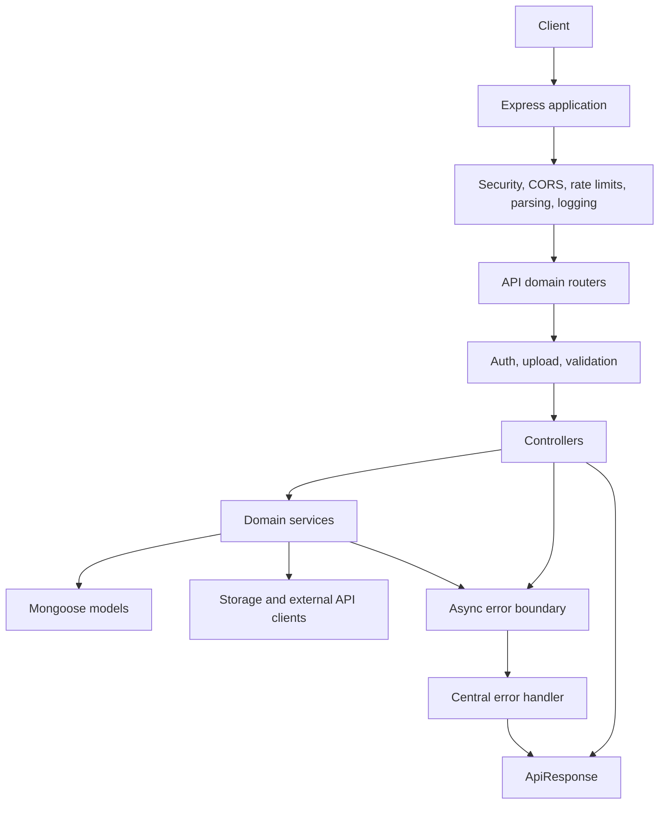

# Insta-Server

A TypeScript and Express API for an Instagram-style social platform. This project focuses on a maintainable backend structure: domain-oriented modules, explicit request validation, service-level data access, centralized error translation, and integrations for authentication, object storage, geocoding, and weather data.

## Engineering Highlights

- **Domain-oriented modules:** Authentication, users, posts, comments, likes, and friendships keep their routes, controllers, services, models, and validation close together.
- **Layered request handling:** Routes compose middleware, controllers handle HTTP concerns, and services coordinate business operations with Mongoose models and shared utilities.
- **Consistent failures and responses:** Promise-based handlers forward errors to a central Express error handler. Custom errors and Zod validation errors are translated into the shared `ApiResponse` envelope.
- **Security controls at the edge:** Helmet, an explicit CORS configuration, general and authentication rate limits, token verification, and request schemas are applied at the application or route boundary.
- **Practical data shaping:** Feed queries sort deterministically by creation time and ID, limit results, project creator fields during population, and batch the current user's like lookup rather than querying likes once per post.
- **Managed startup and external services:** The server loads environment configuration, validates required settings, creates the temporary upload directory, connects to MongoDB, and only then begins listening. Storage, geocoding, and weather integrations are separated from API domains.

## Architecture



### Request lifecycle

`src/core/app.ts` configures shared middleware and mounts health, metadata, sync, and `/api` routes. `src/core/router.ts` delegates API paths to domain routers. Route handlers compose authentication and upload middleware where needed, then use `asyncHandler` to pass rejected promises to the global error handler.

Within a domain, controllers parse and validate HTTP input and build responses; services coordinate business rules and persistence; Mongoose models define database-facing behavior. `CustomError` represents expected domain or resource failures, while Zod errors become validation responses. Both use the same response shape:

```json
{
  "message": "Login success",
  "errorType": null,
  "data": {}
}
```

### Project layout

```text
src/
	apis/                  Domain modules: auth, users, posts, comments, likes, friends, weather
	configs/               Environment, database, CORS, and storage configuration
	core/                  Express app, router, server lifecycle, and shared handlers
	external/              Geocoding and weather API clients
	middlewares/            Authentication, uploads, and rate limiting
	utils/                  Responses, errors, tokens, crypto, and shared helpers
```

## Capabilities

- Email- or username-based login, access tokens, refresh-token validation, and logout.
- User, post, comment, like, and friendship endpoints organized by domain.
- Post media uploads through Multer temporary storage and an AWS SDK object-storage client.
- Weather and geocoding clients isolated under `src/external/`.
- Health and metadata endpoints, plus a separate sync router.
- Zod-based input validation, custom domain errors, and a shared JSON response contract.

Post feed endpoints currently return the latest 10 records; pagination is not implemented in those service methods.

## Stack

| Area                 | Technologies                                              |
| -------------------- | --------------------------------------------------------- |
| Runtime and language | Node.js, TypeScript, strict compiler settings             |
| HTTP                 | Express 4, Helmet, CORS, Morgan, express-rate-limit       |
| Persistence          | MongoDB, Mongoose 8                                       |
| Authentication       | JWT, bcrypt, HTTP-only refresh-token cookie               |
| Validation           | Zod                                                       |
| Integrations         | AWS SDK, Axios, Open-Meteo                                |
| Testing and tooling  | Jest, Supertest, ts-jest, TypeScript, tsc-alias, Prettier |

## Getting Started

### Prerequisites

- Node.js 22 or newer
- Yarn
- A MongoDB connection string
- Object-storage credentials and a bucket for upload operations

### Configuration

The server reads configuration from the environment via `dotenv`. Set these variables before starting the server:

| Variable                                           | Purpose                            |
| -------------------------------------------------- | ---------------------------------- |
| `SERVER_TYPE`                                      | Runtime environment identifier     |
| `PORT`                                             | HTTP listen port                   |
| `MONGO_URI`                                        | MongoDB connection string          |
| `ACCESS_TOKEN_KEY`, `ACCESS_TOKEN_EXPIRY`          | Access-token signing and lifetime  |
| `REFRESH_TOKEN_KEY`, `REFRESH_TOKEN_EXPIRY`        | Refresh-token signing and lifetime |
| `STORAGE_BUCKET_REGION`                            | Object-storage region              |
| `STORAGE_BUCKET_ACC_KEY`, `STORAGE_BUCKET_SEC_KEY` | Object-storage credentials         |
| `STORAGE_BUCKET_NAME`                              | Upload bucket name                 |

Keep credentials out of source control. The refresh cookie is configured as `httpOnly`, `secure`, and `SameSite=None`, so browser-based cross-site use requires HTTPS.

All listed variables must be set: startup validates the environment object before connecting to MongoDB and listening for requests.

### Install and run

```sh
yarn install
yarn dev
```

Build and run the compiled server:

```sh
yarn build
yarn start
```

## Validation and Tests

Run the configured Jest suite with:

```sh
yarn test
```

Tests are colocated in `__test__` directories. Existing tests cover shared response, crypto, token, and common utilities; the auth login test file is currently a placeholder. `mongodb-memory-server` is available as a development dependency, but the checked-in tests do not currently use it. Extending the suite with service and HTTP integration tests is a clear next step for validating domain behavior and middleware contracts end to end.

## Operational Endpoints

- `GET /health` reports basic service health.
- `GET /metadata` returns application metadata.

## Scripts

| Command           | Purpose                                       |
| ----------------- | --------------------------------------------- |
| `yarn dev`        | Run the TypeScript server with reload support |
| `yarn build`      | Compile TypeScript and rewrite path aliases   |
| `yarn start`      | Run the compiled server                       |
| `yarn test`       | Run Jest tests                                |
| `yarn test:watch` | Run Jest in watch mode                        |
| `yarn format`     | Format source files with Prettier             |

## Contribution Workflow

1. Create a focused branch from `dev`.
2. Add or update tests for behavior changes.
3. Run `yarn build`, `yarn test`, and `yarn format` before opening a pull request.
4. Use conventional commit prefixes such as `feat:`, `fix:`, and `chore:`.
